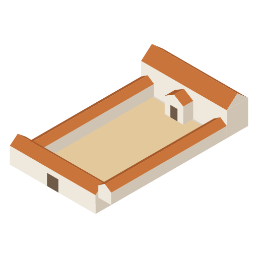

<p align="center"></p>

# Principia

**Your Claude Code dashboard: every instruction in view while the agent works.**

In a long Claude Code session, what you asked for, what the agent plans, what it is doing and what has actually been checked all end up in one scrolling chat. Your corrections get buried, and you end up asking "did you do everything I asked?"

Principia keeps those apart:

- **Requirements ledger.** Each prompt you send is split into separate requirements (R1, R2…) by Claude Haiku, with your exact words kept. A later correction is linked to the requirement it changes; nothing is silently overwritten. You don't label anything.
- **Activity stream.** Edits, commands, tests, plans and the agent's messages, each linked to the requirements its turn worked on, so selecting a requirement shows only what was done for it. Activity recorded before this (and imported sessions) is placed by time: it belongs to the turn of your latest message before it. Reply to any one of them as a **comment** (the agent never sees it), a **new or refined requirement**, or an **instruction** to the agent, optionally interrupting it first. Each reply shows whether the agent actually received it.
- **Completion audit.** A requirement counts as verified only with evidence: a shell command the agent names that ran and exited 0 after its last edit (a test, a build, `ffprobe`, `grep`, `curl`, the project's own script: any Bash call, on its own or inside a compound command), or your own acceptance. The agent saying it's done doesn't count. Work nothing can run for (research, writing, a video to watch) stays *done, not verified* with a note saying what to check by hand, until you accept it. When you settle for something "for now", it's marked **Done for now · revisit** with the condition you gave ("if contributor activity grows"), and listed under *To revisit* instead of as a gap.
- **Statuses that follow the work.** At the end of every turn, Haiku is given every requirement with its status, the edits and tests the agent just ran, and its reply, and moves the requirements that turn affected: *in progress*, *done (not verified)*, *blocked* or *needs you*. The agent can report progress itself too. Only *verified* needs evidence.
- **Signals.** Tool calls that failed or were refused, and things the agent found that were new or unexpected, in one column so you don't have to dig through the chat. Each keeps its context: the requirement, your message that started the turn, what the agent ran and the first of what came back.
- **Conflicts.** When a later message contradicts an earlier requirement, or the agent's work goes against one, the requirement is flagged until you resolve it, and the agent is told to ask you which wins. A deliberate change ("actually, drop the search box") usually counts as a refinement instead; the line between the two is a judgment call, so now and then a correction is flagged as a conflict, and `x` settles it.
- **Footprint.** Each session's memory right now (its process and everything it started) and the files it leaves: its transcript, its ledger, a folder of its own, the project files it changed, its temp folder and what its commands downloaded or cloned, each with how long it stays and whether Time Machine has it. Files its shell commands wrote to (`> file`, `tee`, `sed -i`) count as edits too; changes a script made show up as the project's uncommitted changes. A scratch folder several sessions share is counted once. What git ignores in the project is shown once as shared, not charged to a session, split into dependencies and build output (an install remakes them) and data the project's own commands wrote (nothing remakes it); the computer's package, model and browser caches are shown once too. Conductor and Cursor worktrees count as a session's own folder. The apps themselves (Claude, Claude Code, Conductor, Cursor) get their own block: their memory right now, all processes, and what they keep for their own use (installs, VM images, logs, databases). Sessions that are not running are not measured; a running one measures its whole recorded activity, so it counts files it changed before Principia was updated. `M` in the window.
- **Kept on task.** Every message you send carries what earlier messages asked that is not started or still under way, so a new message does not make the agent drop the last one. When a session goes idle with an ask of yours never started, the agent is told once to continue with it, or to set its status with the reason.
- **Verify, nudged. When a session goes idle with requirements the agent says are done but nothing has checked, Principia asks it, once per requirement per session, to run the command that proves each one, or to say what a person should check when nothing can be run. `/ledger nudge off` stops that.
- **Plan, Tests and Preview.** The agent's todo list with each step linked to the requirements it serves (and the ones it leaves out), every test or build run with the requirements it's evidence for, and the dev servers or preview links its commands printed.
- **Diffs where you read code.** A change opens in Cursor, VS Code or Windsurf, or as a diff in the terminal. No diffs are drawn in the ledger itself.

It shows up in two places: a **pane** inside each Claude Code session, and a **terminal window** that shows every session at once.

<!-- Launch video: replace this comment with the link, e.g. [▶ Watch the launch video](https://…) -->


1. **Title bar:** the session you're looking at, whether its agent is working, and how many requirements are verified.
2. **Sessions:** every Claude Code session running Principia, by project, named as Claude Code names them: ● working, ○ idle, ◌ imported, `·` not running. `S` hides this column.
3. **Requirements:** what you asked for, split from your prompts, each with its status. `/` searches, `F` filters.
4. **Conflict:** a later message, or the agent's work, contradicts this requirement. `x` marks it resolved.
5. **Activity · Plan · Tests · Preview:** what the agent did for the requirement you have selected (`A` shows all of it), its plan linked to your requirements, every test or build run, and preview links.
6. **Signals:** tool calls that failed or were refused, and things the agent found that you may want to act on. Select one to see its context: the requirement, what you had asked, what the agent ran and what came back.
7. **Details:** the selected item: your exact words, refinements, plan steps, evidence, and what you can do with it.
8. **Completion audit:** how many requirements are accounted for and verified, and what still stands in the way. `g` asks the agent to close the gaps. `C` hides it.
9. **Keys:** everything the window does, from the keyboard.

<sub>Drawn from the real window running on demo sessions (`bun scripts/screenshot.ts`).</sub>

## Install

Open Claude Code and paste this. Claude does the rest.

> Install Principia: run **`claude plugin marketplace add aar2dee2/principia`** and then **`claude plugin install principia@principia`**. Then tell me to start a new Claude Code session, where Principia will ask whether it may read my existing transcripts to show earlier sessions; then run `/ledger window` to open the dashboard in my terminal, and ask whether I want to match my brand's colours with `/ledger theme import <my website or tailwind.config.js>`.

Works in the Claude Code terminal app and in the Claude desktop app's Code tab, on macOS, Windows and Linux.

**Requirements:** [Claude Code](https://docs.anthropic.com/en/docs/claude-code) with plugin hooks, and [Git](https://git-scm.com/) for diffs. No Node, no Python.

The plugin runs inside Claude Code. The terminal window and the transcript importer are one standalone program, `principia` (built with Bun for macOS, Windows and Linux; 60–115 MB). The first `/ledger window` tells you this and asks you to run `/ledger install`.

### Update

> Update Principia: run `claude plugin marketplace update principia` and then `claude plugin update principia@principia`.

Then start a new session and run `/ledger install` once more: each version of the plugin uses its own build of the program. An open window switches to the new build by itself, and the old one is removed.

### Uninstall

> Uninstall Principia: run `claude plugin uninstall principia@principia` and `claude plugin marketplace remove principia`.

Your ledgers stay in `~/.claude/principia` until you delete that folder.

### Coming from Praetorium

Principia was called Praetorium up to 0.3.8. Uninstall that one (`claude plugin uninstall praetorium@praetorium` and `claude plugin marketplace remove praetorium`), install Principia as above, and start a new session: your ledgers move from `~/.claude/praetorium` to `~/.claude/principia` on their own. The plugin's own settings (transcript permission, pane width) start afresh, so it asks about transcripts once more.

## Commands

Type these in any Claude Code session where Principia is installed.

### `/ledger`

Opens the Principia pane beside the conversation, with tabs for Requirements, Signals, Activity, Plan, Tests, Preview and Audit. It opens on its own when a session starts; use this to bring it back after closing it.

### `/ledger wide` · `/ledger narrow`

Asks for a wide pane (requirements, signals, activity and audit side by side) or a narrow one (tabs). Remembered across sessions. Dragging the pane's edge works too, and wins.

### `/ledger window`

Opens the dashboard in its own terminal window, showing **every** Claude Code session running Principia, not just this one. There's only ever one window: if it's already open, this switches it to the session you ran the command from. The first time, it asks you to run `/ledger install`.

### `/ledger window <terminal>`

The same, in a terminal you choose, remembered from then on. Without a name, the first installed one is used:

| macOS | Windows | Linux |
|---|---|---|
| `iterm`, `ghostty`, `wezterm`, `kitty`, `warp`, `terminal` | `wt` (Windows Terminal), `wezterm`, `pwsh`, `powershell`, `cmd` | `ghostty`, `wezterm`, `kitty`, `alacritty`, `gnome-terminal`, `konsole`, `x-terminal-emulator` |

### `/ledger install`

Downloads the `principia` program for your system from this repository's GitHub releases, checks it against the SHA-256 recorded in the plugin (a mismatch is deleted, never run), checks that it starts, and keeps it in `~/.claude/principia/bin`. Needed once per Principia version, for `/ledger window` and `/ledger import`.

### `/ledger nudge on` · `/ledger nudge off`

Whether Principia prompts the agent on its own: to continue with an ask of yours it never started, and to verify requirements it says are done. On by default: when a turn ends and the session stays idle for 20 seconds with such requirements, the agent is asked once per requirement to run the command that proves it, or to record what a person should check when nothing can be run (that requirement is then left alone). `g` in the window asks at any time.

### `/ledger refresh`

Reads this session's **whole** conversation, from the first message: adds any requirement the ledger missed (existing ones keep their ids) and corrects any status that's wrong. Use it if statuses look stale, for example in a session that ran before Principia judged progress on its own. Reads this session's transcript, so it needs your permission (below). A long session takes a minute or two.

### `/ledger import [days]`

Adds sessions you started **before** installing Principia, read from their Claude Code transcripts: the last 2 days by default, up to 30. Each appears in the window (marked ◌, read-only) with its requirements, and the status each one reached in the conversation. Needs your permission first (below).

### `/ledger import refresh [days]`

The same, and also rebuilds sessions imported before, so they're read with the current rules.

### `/ledger import allow` · `/ledger import revoke`

Gives or withdraws permission to read transcripts. The first session after installing asks in a dialog; these change the answer later.

### `/ledger theme`

Shows the current theme and the presets.

### `/ledger theme <preset>`

Switches to `graphite` (the default), `paper` or `telborg`.

### `/ledger theme import <website | tailwind.config.js | file.css | theme.json>`

Builds a theme from your brand (see [Your own colours](#your-own-colours)).

## The terminal window

Titled **Principia - Your Claude Code Dashboard**. Sessions are listed by project with the names Claude Code gives them; ● working, ○ idle, ◌ imported, · not running. Only running sessions accept replies: one that has stopped says so instead of taking a message nobody would read.

| Key | Does |
|---|---|
| Tab · ←/→ | Move between columns |
| ↑/↓ | Move the selection |
| `[` · `]` | Previous / next session |
| `S` | Show or hide the Sessions column, for more room on one session |
| `C` | Show or hide the Completion audit (the selected item's details stay) |
| `A` | Activity for the selected requirement only · all activity |
| `M` | Footprint: each session's memory and files, with how long they stay and whether they're backed up |
| `1`–`5` | Activity, Plan, Tests, Preview, Signals |
| `/` · `F` | Search requirements · cycle the filter (open, done but not verified, verified, to revisit, conflicts, yours, the agent's) |
| `c` or Enter | Comment on the selected event (the agent doesn't see it) · on a signal, go to its event · on a preview, open it |
| `n` | New requirement · on a signal, make the signal one |
| `f` | Refine the selected requirement |
| `i` | Instruction to the agent · Ctrl-T while typing interrupts it first |
| `x` | Resolve a requirement's conflict · dismiss a signal |
| `o` · `t` | Open the change's diff in your editor · in the terminal |
| `a` · `d` | Accept a requirement as verified · defer it |
| `g` | Ask the agent to close every open gap |
| `v` | All events, or key events only |
| `l` · `h` | Light or dark · show headless sessions (`claude -p` and SDK runs, which never draw the pane) |
| `q` | Quit |

Colours are full 24-bit where the terminal supports it, and the nearest of 256 elsewhere (Apple Terminal, older consoles).

## Sessions from before Principia

Sessions started before you installed Principia don't run it, so nothing in them can reach the agent. Their transcripts can still be read, with your permission:

- **Asked first.** The first session after installing shows a dialog explaining what would be read. Nothing is read until you choose Allow, including the session titles the window shows (until then it shows each session's first prompt). Change the answer with `/ledger import allow` or `revoke`.
- **What is read.** From `~/.claude/projects` (or `$CLAUDE_CONFIG_DIR/projects`): your prompts, the agent's replies, and the name and file path or command of each tool call. File contents and diffs are not kept. Nothing is written to the transcripts.
- **When.** Once you allow it, sessions from the last 2 days are imported then, and each new session start imports any recent ones still missing (at most every 10 minutes).
- **How it's read.** The whole conversation, from the first message, including messages sent while the agent was working, in three passes. First your asks, a few messages at a time, each pass given every requirement found so far; then a check of all your messages against the ledger for anything missed; then each requirement's status, judged against everything the agent said afterwards. Early requirements in long sessions are never dropped. A session started from another session counts the task it was given as yours (you asked for it there); `claude -p` runs don't count.
- **What it costs.** A few Claude Haiku calls per session: about one per 5 messages.
- **Reopen to connect.** When you reopen an old session, Principia loads in it and takes over its imported ledger. From there, replies, instructions and interrupts work as usual.

## Your own colours

A theme is eleven colours per mode: `bg`, `surface`, `surface2`, `border`, `text`, `text2`, `text3`, and four for status: `done` (verified), `active` (in progress), `warn` (needs review), `danger` (failed or blocked).

```text
/ledger theme import https://yourcompany.com
/ledger theme import ./tailwind.config.js
/ledger theme import ./src/app.css
/ledger theme import ./my-theme.json
```

- **A website**: its `theme-color`, inline styles and up to four stylesheets are read.
- **A Tailwind config or a CSS file** (Tailwind v3 `colors`, v4 `@theme`, CSS variables): only the lines carrying colours are read.
- **Any of those** goes to Claude Haiku, which maps your brand onto the eleven colours for both modes.
- **A theme JSON** in Principia's own format is used as is, with no model call:

```json
{
  "name": "acme",
  "dark":  { "bg": "#0b0b0f", "text": "#ececf1", "done": "#22c55e", "active": "#06b6d4" },
  "light": { "bg": "#ffffff", "text": "#111111", "done": "#15803d", "active": "#0e7490" }
}
```

Missing colours come from the default theme, and any colour too faint to read on its background (below WCAG contrast) is replaced, so an import can't make the dashboard unreadable.

## How accurate it is

Measured on two of the long sessions Principia was built in, each requirement and status checked by Fable 5.1 against the full conversation (`bun scripts/eval-ledger.mjs <session id>`):

| | Requirements that are real asks | Statuses right | Asks missed |
|---|---|---|---|
| Built from the whole transcript (`/ledger import`, `/ledger refresh`), 43 messages | 49/51 | 48/49 (98%) | 2 |
| Built from the whole transcript, 89 messages | 95/102 | 85/95 (89%) | 4 |
| Live, turn by turn, as you work (the 43 messages replayed) | 60/61 | 52/60 (87%) | 4 |

Live statuses run a little behind: most of the misses are work the agent finished that was still shown in progress. Each turn's review sees only that turn, so every 6 turns every open requirement is judged again against the whole session. `/ledger refresh` reads the whole conversation again and corrects the rest. Statuses are never set to verified this way: that still needs a passing check or your acceptance.

## Cost and footprint

- **Per prompt:** one short Claude Haiku call to tag requirements. It also reads the agent's previous reply (up to 1,500 characters), because a message like "can we not get X?" only reads one way in context. Headless (`claude -p`) sessions aren't tagged.
- **Per agent turn:** one more Haiku call, to move requirement statuses, pick out findings worth acting on, and check the work against your requirements.
- **Every 6 turns:** one Haiku call per 30 turns of the session so far (your messages and the agent's answers, clipped; the whole transcript if you allowed reading transcripts), judging every open requirement's status. A 60-turn session makes two calls each time.
- **Per request:** about 225 tokens of tool definition, for the `ledger` tool the agent uses to report progress and evidence.
- **Imports and `/ledger refresh`:** a few Haiku calls per session, more for long ones: the three passes read the whole conversation, a few messages at a time.
- **Reopening a session after an update:** once per version, the whole conversation is read again, as `/ledger refresh` does, so ledgers kept by older versions get the same statuses.
- **Theme imports:** one Haiku call.
- **Files:** none in your projects. Everything lives in `~/.claude/principia`: one small ledger per session (dropped after 30 days unused), pre-edit copies for diffs in `snapshots/` (dropped after 7 days; files that may hold secrets, like `.env` or keys, are never copied), and the program in `bin/` (older versions removed).

## What Principia reads, runs and sends

Everything stays on your machine, except the model calls, which go through your own Claude account like any other Claude Code request.

- **Reads:** the messages you send and the agent's replies and tool calls in sessions where Principia runs (through Claude Code's plugin hooks). With your permission only: earlier sessions' transcripts in `~/.claude/projects` (for `/ledger import`, `/ledger refresh` and session titles in the window).
- **Writes:** `~/.claude/principia` (each session's ledger, the window's settings and heartbeat, copies of files before edits for diffs) and the plugin's own store. Nothing is written into your projects or transcripts.
- **Sends:** short Claude Haiku requests through Claude Code: your message and the agent's last reply when tagging, the requirement list and each turn's reply and work for the per-turn review, and transcripts when you import or refresh. No other server receives anything, and there is no telemetry.
- **Fetches:** only when you ask. `/ledger install` downloads the `principia` program from this repository's GitHub releases (checked against its SHA-256 before it runs); `/ledger theme import <url>` fetches that page and its stylesheets.
- **Runs:** the `principia` program (window, importer, diff), your terminal app to open the window, your editor to show a diff, and `git`, `curl`, `shasum`/`certutil` as named above.

## Your secrets

Principia never reads env files or other files that may hold secrets: `.env` and every `.env.*`, `.npmrc`, `.netrc`, `.pgpass`, SSH keys (`id_rsa`, `id_ed25519`, `id_ecdsa`), `*.pem`, `*.key`, `*.p12`, `*.pfx`, `credentials*` and `secret(s).*`. It doesn't copy them for diffs, doesn't open their diffs (in the pane, the window or the program), and won't import a theme from one. When the agent edits such a file, the activity shows that it did, never what's inside.

It does read a few environment *variables*, only to find its folders and the right terminal: `HOME` / `USERPROFILE`, `CLAUDE_CONFIG_DIR`, `TMPDIR` / `TEMP` / `TMP`, `SHELL`, `OS`, `CLAUDE_CODE_ENTRYPOINT`, and in the window `TERM`, `TERM_PROGRAM`, `COLORTERM`, `WT_SESSION`, `KITTY_WINDOW_ID`. Nothing else, and none are stored or sent anywhere.

## How it works

Principia is a Claude Code plugin made of function hooks (`hooks/register.tsx`):

- `prompt.submit` tags requirements with Haiku, flags conflicts, and tells the agent the ids.
- `tool.call` turns edits, commands, tests and plans into activity, records failed or refused calls as signals (with what was run and what came back), and copies a file before it is edited (for diffs). It never fails your tool call, even if Principia itself errors.
- `turn.start` / `turn.complete` track whether the agent is working, record its answers, and run the per-turn review. The requirements a turn worked on (the ones your message touched, the plan step in progress, the ones the agent reported on or the review judged) are linked to every event of that turn.
- The `ledger` tool lets the agent report progress; `verified` is refused unless `test_command` names part of a Bash call that exited 0 after the agent's last Edit or Write (files changed by shell commands are not edits). The refusal says which of those failed. `manual_check` records what a person should check when nothing can be run.
- Replies reach the agent inside its running turn, start a new turn, or wait for your next prompt, and say which happened.
- `viewer/` is the `principia` program (`cli.mjs`): the terminal window (`ledger-view.mjs`), which reads each session's ledger and writes your actions to an inbox the session polls; the transcript importer (`import.mjs`); and the diff view. `scripts/build.ts` compiles it per platform and records the checksums in `hooks/release.ts`.
- `hooks/tagging.ts` holds the Haiku prompts; `hooks/work.ts` links plan steps, finds preview links and filters requirements, shared by the pane and the window.

## Develop

```bash
git clone https://github.com/aar2dee2/principia.git
```

Run Claude Code from your clone instead of the marketplace build by adding this to the `env` block of `~/.claude/settings.json`, then start a new session. Edits reload live, and with [Bun](https://bun.sh) installed the window runs from source. Don't also install it from the marketplace, or it loads twice; remove these lines before going back to the installed version.

```json
"CLAUDE_CODE_PLUGIN_DIRS": "/path/to/principia",
"CLAUDE_CODE_PLUGIN_DIR_WATCH": "1"
```

```bash
claude plugin validate .
```

```bash
claude plugin test .
```

```bash
bun scripts/build.ts
```

```bash
bun scripts/screenshot.ts
```

Live checks against the real model and your machine (Claude Code signed in):

```bash
bun scripts/live-check.mjs tagging
```

```bash
bun scripts/live-check.mjs theme https://yourcompany.com
```

```bash
bun scripts/live-check.mjs terminal iterm
```

```bash
bun scripts/live-check.mjs import <session id>
```

### Releasing

Bump the version in `.claude-plugin/plugin.json`, run `bun scripts/build.ts` (it rewrites `hooks/release.ts` with the new checksums), commit, tag `v<version>` on that commit, and publish `dist/principia-*` as that tag's release.

## License

MIT
